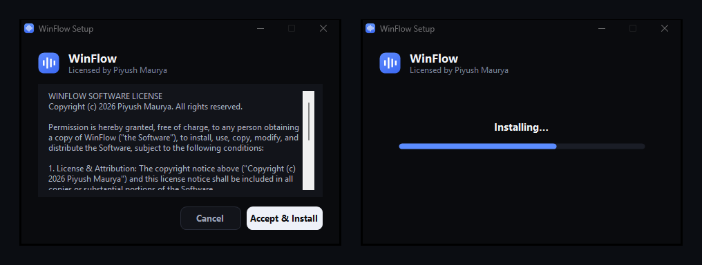
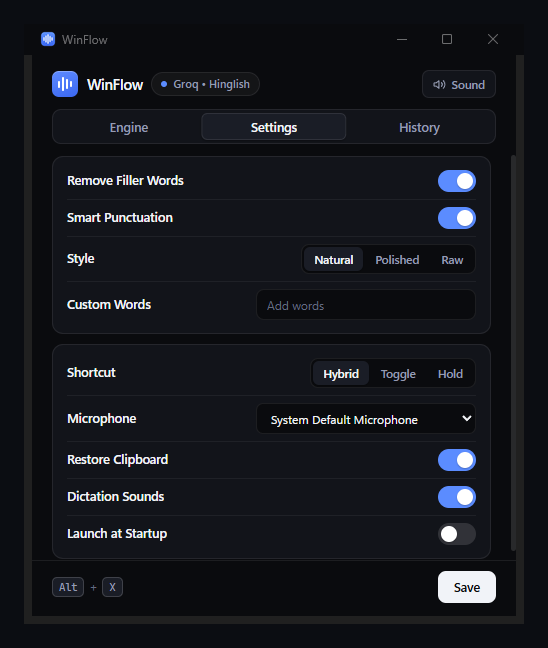
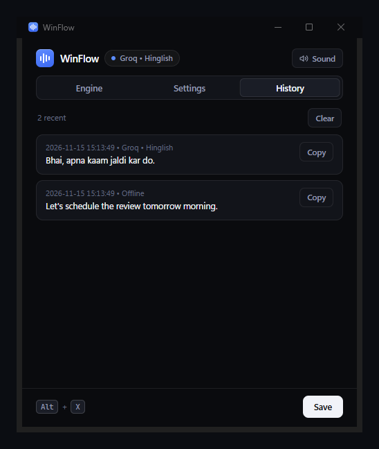

<div align="center">


<br />

# WinFlow

**Fast, clean AI voice dictation for Windows 10 & 11 — licensed by Piyush Maurya.**  
Press **`Alt + X`** in any app to speak and paste clean text in ~0.8s, while keeping native Windows Voice Typing (**`Win + H`**) untouched.

<p>
  <a href="https://github.com/piyushmaurya6/winflow/releases/latest/download/WinFlow-Setup.exe"></a>
  <a href="https://github.com/piyushmaurya6/winflow/releases/latest"></a>
  <a href="https://github.com/piyushmaurya6/winflow/actions/workflows/ci.yml"></a>
  <a href="LICENSE"></a>
</p>

<p>
  <a href="#-download--install"><b>Download & Install</b></a> •
  <a href="#-features"><b>Features</b></a> •
  <a href="#-screenshots"><b>Screenshots</b></a> •
  <a href="#-shortcuts"><b>Shortcuts</b></a> •
  <a href="#-supported-providers"><b>Providers</b></a>
</p>

</div>

---

## 📥 Download & Install

| Package | Platform | Direct Download |
| :--- | :--- | :--- |
| **`WinFlow-Setup.exe`** *(Recommended)* | Windows 10 / 11 (64-bit) | [**⬇ Download Standalone Installer (`WinFlow-Setup.exe`)**](https://github.com/piyushmaurya6/winflow/releases/latest/download/WinFlow-Setup.exe) |
| **`WinFlow-Portable-x64.zip`** | Windows 10 / 11 (64-bit) | [**⬇ Download Portable App (`.zip`)**](https://github.com/piyushmaurya6/winflow/releases/latest/download/WinFlow-Portable-x64.zip) |

1. Download and run **`WinFlow-Setup.exe`**.
2. Click **Accept & Install** — a single clean progress bar installs `WinFlow.exe`, Desktop & Start Menu shortcuts, and uninstaller automatically (zero Python, PowerShell, or `.bat` scripts needed).
3. Click **Open WinFlow** and press **`Alt + X`** in any app to dictate.

<div align="center">
  
</div>

---

## ✨ Features

- **Standalone Native `.exe` App & Installer** — Self-contained 64-bit `WinFlow-Setup.exe` and `WinFlow.exe` licensed by **Piyush Maurya**, with clean Desktop/Start Menu shortcuts and Windows Installed Apps (`Uninstall-WinFlow.exe`) support.
- **Simple, Clean Native App UI** — Minimalist dark Windows 11 interface with tactile button sounds, zero clutter, and instant `Paste` + `Apply` API key setup.
- **Hinglish + English + Hindi** — Speak Hindi in **`Hinglish`** mode to type clean Romanized English letters (like `"Apna"`), or switch to **`English`**, **`Hindi`**, or **`Auto`**.
- **8 Cloud Providers + 100% Offline Mode** — Connect **Groq**, **Gemini**, **GPT**, **Claude**, **Grok**, **NVIDIA**, **Kimi**, or any **Custom** OpenAI-compatible endpoint — or run **Offline** locally via `faster-whisper` with no API key.
- **Smart Disfluency Cleanup** — Strips filler words, collapses repeated stutters, and pastes straight at your cursor without stealing window focus.
- **Coexists with Native Windows Dictation** — WinFlow uses **`Alt + X`** (tap to toggle, hold for push-to-talk, `Esc` to cancel) and leaves **`Win + H`** untouched.

---

## 📸 Screenshots

### Floating Status Pill


### App Interface
<table>
  <tr>
    <td width="50%">
      
      <p align="center"><sub><b>Engine, Language & Provider</b></sub></p>
    </td>
    <td width="50%">
      
      <p align="center"><sub><b>Settings & Shortcut</b></sub></p>
    </td>
  </tr>
</table>

<div align="center">
  
  <p><sub><b>Dictation History</b></sub></p>
</div>

---

## ⌨️ Shortcuts

| Shortcut | Action |
| :--- | :--- |
| **Tap `Alt + X`** | Start / stop hands-free dictation |
| **Hold `Alt + X`** | Push-to-talk (pastes on release) |
| **`Esc`** *(while recording)* | Cancel active dictation |
| **`Win + H`** | Native Windows Voice Typing (untouched) |

---

## ☁️ Supported Providers

| Mode / Provider | Key Portal |
| :--- | :--- |
| **Offline** *(No key needed)* | Built-in `faster-whisper` (`Tiny` / `Base` / `Small`) |
| **Groq** | [console.groq.com/keys](https://console.groq.com/keys) |
| **Gemini** | [aistudio.google.com/apikey](https://aistudio.google.com/apikey) |
| **GPT (OpenAI)** | [platform.openai.com/api-keys](https://platform.openai.com/api-keys) |
| **Claude (Anthropic)** | [console.anthropic.com/settings/keys](https://console.anthropic.com/settings/keys) |
| **Grok (xAI)** | [console.x.ai](https://console.x.ai/) |
| **NVIDIA** | [build.nvidia.com](https://build.nvidia.com/explore/discover) |
| **Kimi (Moonshot)** | [platform.moonshot.ai](https://platform.moonshot.ai/console/api-keys) |
| **Custom** | OpenRouter, DeepSeek, Together, Ollama, or any OpenAI-compatible URL |

---

## 🛠️ Build From Source (Developers)

```powershell
git clone https://github.com/piyushmaurya6/winflow.git
cd winflow
uv venv --python 3.12 .venv
uv pip install --python .venv\Scripts\python.exe -r pyproject.toml pyinstaller
.\.venv\Scripts\python.exe tests\unit_test.py
.\.venv\Scripts\python.exe scripts\build_release.py
```

Outputs `release_artifacts\WinFlow-Setup.exe` and `release_artifacts\WinFlow-Portable-x64.zip`.

---

## 📄 License

Copyright © 2026 **[Piyush Maurya](https://github.com/piyushmaurya6)**. Released under the [MIT License](LICENSE).
