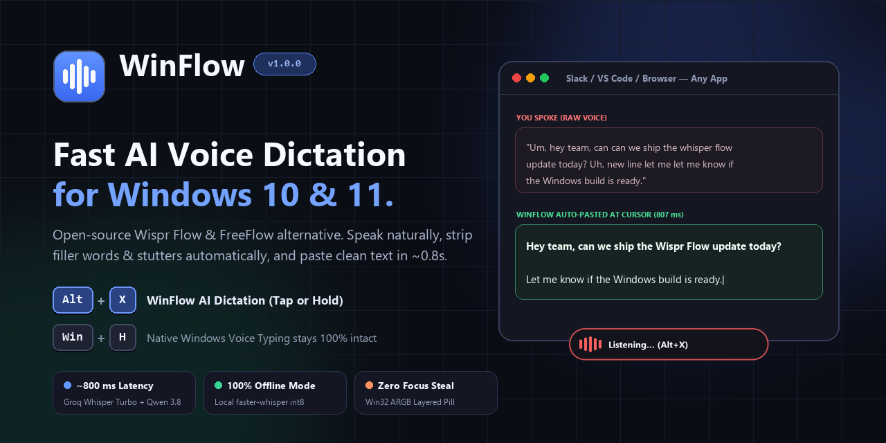
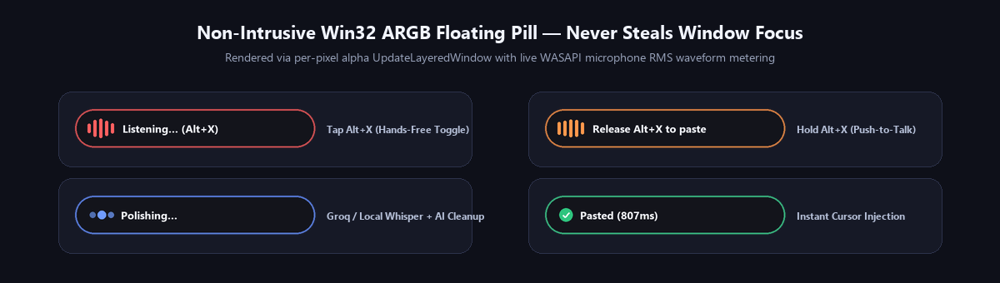
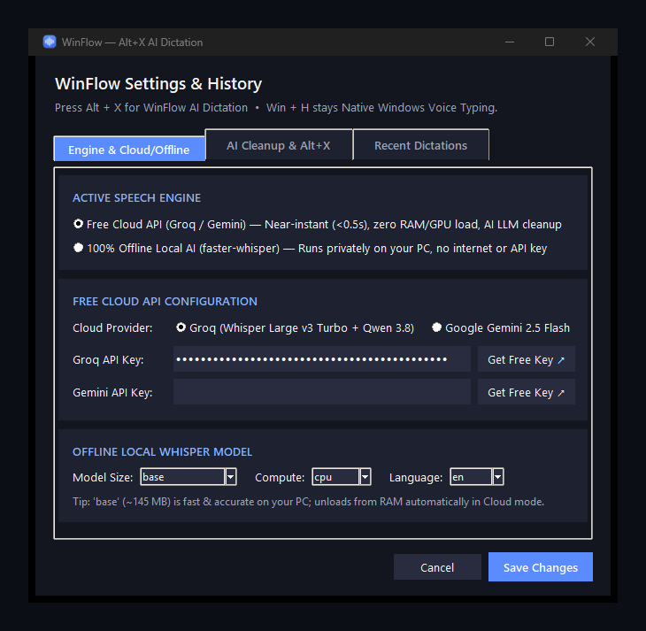
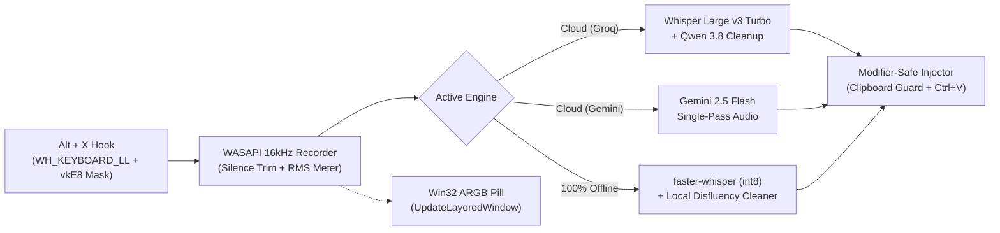

<div align="center">



<br />

# WinFlow

**Fast, open-source Wispr Flow & FreeFlow alternative built natively for Windows 10 & 11.**  
Speak naturally anywhere with **`Alt + X`** — strip filler words & stutters automatically and paste clean text in **~0.8s**, while keeping native Windows Voice Typing (**`Win + H`**) 100% intact.

<p>
  <a href="https://github.com/piyushmaurya6/winflow/releases/latest"></a>
  <a href="https://github.com/piyushmaurya6/winflow/releases/download/v1.0.0/WinFlow-v1.0.0-Windows-x64.zip"></a>
  <a href="https://github.com/piyushmaurya6/winflow/actions/workflows/ci.yml"></a>
  <a href="LICENSE"></a>
</p>

<p>
  <a href="#-download--quick-install"><b>Download & Install</b></a> •
  <a href="#-key-features"><b>Features</b></a> •
  <a href="#-screenshots"><b>Screenshots</b></a> •
  <a href="#-keyboard-shortcuts"><b>Shortcuts</b></a> •
  <a href="#-cloud-vs-offline-modes"><b>Cloud vs Offline</b></a> •
  <a href="#-architecture"><b>Architecture</b></a>
</p>

</div>

---

## Why WinFlow?

Tools like **Wispr Flow** (paid subscription) and **FreeFlow** (macOS-only) transformed voice dictation by combining instant Whisper transcription with LLM disfluency cleanup. Meanwhile, Windows' built-in `Win + H` types raw unedited speech, leaves stutters and *"um/uh"* fillers in your text, and struggles with technical vocabulary.

**WinFlow** brings the full AI dictation workflow natively to **Windows 10 & 11** — completely free and open-source:

| Capability | Windows `Win + H` | FreeFlow | Wispr Flow | **WinFlow** |
| :--- | :---: | :---: | :---: | :---: |
| **Runs Natively on Windows 10/11** | ✅ | ❌ *(macOS only)* | ✅ | ✅ |
| **100% Free & Open Source (MIT)** | ✅ | ✅ | ❌ *(Paid)* | ✅ |
| **Removes Fillers (`um`, `uh`) & Stutters (`can Can`)** | ❌ | ✅ | ✅ | ✅ |
| **Custom Tech & Name Dictionary** | ❌ | ✅ | ✅ | ✅ |
| **Sub-Second Cloud Mode (Free BYOK Groq / Gemini)** | ❌ | ✅ | ✅ | ✅ *(~800 ms)* |
| **100% Offline Local Mode (`faster-whisper`)** | ❌ | ✅ | ❌ | ✅ |
| **Keeps Native Windows `Win + H` Working Too** | — | — | ✅ | ✅ *(Uses `Alt + X`)* |

---

## 📥 Download & Quick Install

### Option 1 — One-Line PowerShell Install *(Recommended)*
Open **PowerShell** and run:

```powershell
irm https://raw.githubusercontent.com/piyushmaurya6/winflow/main/scripts/install.ps1 | iex
```

> Automatically downloads WinFlow, sets up an isolated Python 3.12 runtime via `uv`, creates **Desktop** & **Start Menu** shortcuts with the WinFlow icon, and launches WinFlow in your System Tray.

### Option 2 — Direct Release Download (No Git Required)

| Package | Platform | Direct Download Link |
| :--- | :--- | :--- |
| **`WinFlow-v1.0.0-Windows-x64.zip`** | Windows 10 / 11 (64-bit) | [**⬇ Download Portable Bundle (.zip)**](https://github.com/piyushmaurya6/winflow/releases/download/v1.0.0/WinFlow-v1.0.0-Windows-x64.zip) |
| **`WinFlow-QuickInstaller.bat`** | Windows 10 / 11 (64-bit) | [**⬇ Download 1-Click Installer (.bat)**](https://github.com/piyushmaurya6/winflow/releases/download/v1.0.0/WinFlow-QuickInstaller.bat) |
| **All Releases & Checksums** | GitHub Releases | [**View v1.0.0 Release Notes ↗**](https://github.com/piyushmaurya6/winflow/releases/tag/v1.0.0) |

1. Download and extract **`WinFlow-v1.0.0-Windows-x64.zip`**.
2. Double-click **`Install-And-Run.bat`** once to finish setup and create your Desktop shortcut.
3. Anytime afterward, launch silently via your **WinFlow** Desktop shortcut or **`Start-WinFlow.vbs`** (or enable **Launch at Windows Startup** in the tray menu).

### Option 3 — From Source (Developers)

```powershell
git clone https://github.com/piyushmaurya6/winflow.git
cd winflow
uv venv --python 3.12 .venv
uv pip install --python .venv\Scripts\python.exe -r pyproject.toml
wscript.exe Start-WinFlow.vbs
```

---

## ✨ Key Features

- **⚡ Sub-Second Cloud Dictation (~800 ms)** — Powered by **Groq** (`whisper-large-v3-turbo` + `qwen/qwen3.8-27b`) or **Google Gemini** (`gemini-2.5-flash`) using your own free API key, with persistent TLS connection pooling and automatic silence trimming.
- **🔒 100% Private Offline Mode** — Switch to **Offline Local Whisper** (`faster-whisper` `int8` with Silero VAD) in 1 click from the system tray. Loads cached models with `local_files_only=True` (zero network requests) and automatically unloads from RAM when you switch back to Cloud mode.
- **🧠 Wispr-Style AI Disfluency Cleanup** — Strips vocal hesitations (*"um"*, *"uh"*, *"like"*, *"you know"*), collapses repeated stutters (*"can Can we"* → *"Can we"*), applies your **Custom Words** dictionary (*"whisper flow"* → *"Wispr Flow"*), and executes voice formatting commands (*"new line"*, *"new paragraph"*).
- **🎹 Smart Hybrid `Alt + X` Hook (`WH_KEYBOARD_LL`)** — Tap `Alt + X` quickly to latch hands-free toggle mode, or hold `Alt + X` for push-to-talk. Suppresses the Windows `Alt` menu-bar highlight (`vkE8` mask) while leaving native **`Win + H`** completely untouched.
- **🪶 Zero-Focus-Steal ARGB Pill Overlay** — Rendered directly via Win32 `UpdateLayeredWindow` (`WS_EX_LAYERED | WS_EX_NOACTIVATE | WS_EX_TRANSPARENT`) with 2x supersampled anti-aliasing and live WASAPI microphone waveform metering.
- **📋 Clipboard-Safe Instant Injection** — Pastes polished text straight into VS Code, Slack, Chrome, Notion, Word, or Windows Terminal and automatically restores your previous clipboard contents afterward.

---

## 📸 Screenshots

### Floating Waveform Pill States


### Dark Windows 11 Settings & Dictation History
<table>
  <tr>
    <td width="50%">
      
      <p align="center"><sub><b>Engine & Free Cloud / Offline Configuration</b></sub></p>
    </td>
    <td width="50%">
      
      <p align="center"><sub><b>Wispr-Style AI Cleanup, Custom Dictionary & Microphone</b></sub></p>
    </td>
  </tr>
</table>

<div align="center">
  
  <p><sub><b>Recent Dictations Log with Latency Metrics & One-Click Copy</b></sub></p>
</div>

---

## ⌨️ Keyboard Shortcuts

| Shortcut | Action | Behavior |
| :--- | :--- | :--- |
| **Tap `Alt + X`** *(<350 ms)* | **Hands-Free Toggle** | Starts recording immediately; press **`Alt + X`** again when finished to transcribe, clean, and paste. |
| **Hold `Alt + X`** *(≥350 ms)* | **Push-to-Talk** | Records for as long as you hold `Alt + X`; release to transcribe, clean, and paste immediately. |
| **`Esc`** *(while recording)* | **Cancel Dictation** | Cancels the active recording without pasting (`Esc` behaves normally in all apps when idle). |
| **`Win + H`** | **Native Windows Voice Typing** | Left **100% untouched** so you can still use built-in Windows dictation whenever you want. |

---

## ☁️ Cloud vs Offline Modes

Right-click the **WinFlow icon** in the Windows System Tray (blue in Cloud mode, green in Offline mode, grey when Paused) to switch engines instantly:

| Mode | Speech-to-Text | Cleanup Engine | Typical Latency (30w) | RAM Usage | API Key Needed? |
| :--- | :--- | :--- | :--- | :--- | :--- |
| **Cloud — Groq** *(Recommended)* | `whisper-large-v3-turbo` | `qwen/qwen3.8-27b` | **~700 – 900 ms** | ~35 MB | Free key from [console.groq.com](https://console.groq.com/keys) |
| **Cloud — Google Gemini** | `gemini-2.5-flash` *(Multimodal)* | Single-pass Gemini 2.5 | **~950 – 1,300 ms** | ~35 MB | Free key from [aistudio.google.com](https://aistudio.google.com/apikey) |
| **Offline Local** | `faster-whisper` (`tiny`/`base`/`small`) | Deterministic NLP Cleaner | **~1.1 – 1.6 s** *(CPU)* | ~260 MB | **None (100% Offline)** |

---

## 🏗️ Architecture



### Project Layout

```text
winflow/
├── assets/
│   ├── logo.png                # High-resolution WinFlow brand mark
│   └── winflow.ico             # Multi-size Windows icon (16px – 256px)
├── docs/images/                # Product screenshots & pill showcase
├── scripts/
│   ├── install.ps1             # Remote & local PowerShell 1-liner installer
│   └── generate_assets.py      # Reproducible icon & screenshot builder
├── tests/
│   ├── unit_test.py            # Deterministic Windows CI unit tests
│   └── self_test.py            # Full end-to-end audio/STT/UI integration suite
├── winflow/
│   ├── app.py                  # Tray controller, watchdog & lifecycle orchestrator
│   ├── audio.py                # 16 kHz WASAPI capture, silence trim & soft cues
│   ├── cleaner.py              # Disfluency/stutter stripper & LLM prompt builder
│   ├── config.py               # Thread-safe config & HKCU Startup registry helper
│   ├── engine.py               # Groq, Gemini & faster-whisper unified speech engine
│   ├── hotkey.py               # Native Win32 WH_KEYBOARD_LL Alt+X hook
│   ├── injector.py             # Modifier-aware SendInput paste & clipboard restore
│   ├── overlay.py              # Per-pixel ARGB UpdateLayeredWindow floating pill
│   └── settings_ui.py          # Dark Windows 11 multi-tab Settings & History UI
├── config.example.json         # Example configuration template
├── Install-And-Run.bat         # One-click local setup & launcher
├── Start-WinFlow.vbs           # Silent windowless background launcher
├── Start-WinFlow.bat           # Batch launcher
└── pyproject.toml              # Project metadata & dependencies
```

---

## 🛡️ Privacy & Security

- **Zero Telemetry:** WinFlow collects zero analytics or telemetry.
- **Local Key Storage:** API keys are stored only on your machine in `config.json` (git-ignored).
- **Administrator Windows Note:** Due to Windows UIPI (User Interface Privilege Isolation), standard user-level apps cannot intercept shortcuts while an *elevated* ("Run as Administrator") window holds focus unless WinFlow is also launched as Administrator.

See [SECURITY.md](SECURITY.md) for full details.

---

## 🤝 Contributing

Contributions, bug reports, and feature ideas are welcome! Check out [CONTRIBUTING.md](CONTRIBUTING.md) to get started and run the test suite:

```powershell
.\.venv\Scripts\python.exe tests\unit_test.py
```

---

## 📄 License

Released under the [MIT License](LICENSE). Copyright © 2026 [Piyush Maurya](https://github.com/piyushmaurya6).
